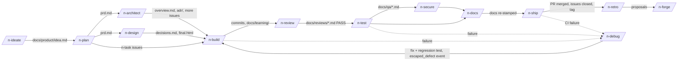

# Artifact graph

Skills are nodes. Artifacts (files, GitHub issues, commits) are the edges. A skill can run
once its required inputs exist.

| Skill | Requires | Writes |
|---|---|---|
| `/n-init` | a git repo | `.n-stack/config.json`, `.n-stack/bin/`, `.githooks/`, `CLAUDE.md`, docs skeleton, CI workflow |
| `/n-ideate` | — | `docs/product/idea.md`, `idea_session` event |
| `/n-plan` | idea.md or a clear request | `docs/product/prd.md`, `n-task` issues + milestones |
| `/n-architect` | prd.md | `docs/architecture/overview.md` (drift-tracked), `adr/NNNN-*.md`, issues |
| `/n-design` | prd.md | `docs/design/explorations/<slug>/`, `decisions.md` (drift-tracked), `design-system.md` |
| `/n-build` | ready issues, verify command | commits, issue status labels, `docs/learning/` |
| `/n-debug` | a failure | fix + regression test, `docs/learnings.md`, `escaped_defect` event |
| `/n-review` | commits ahead of base | `docs/reviews/<date>-<branch>.md` (parsed by the gate) |
| `/n-test` | runnable project | tests, `docs/qa/<date>-<branch>.md` |
| `/n-secure` | branch or app | `docs/security/<date>.md` |
| `/n-docs` | stale docs | updated + re-stamped docs |
| `/n-ship` | `nstack-gate` PASS | PR (`Closes #…`), `CHANGELOG.md`, tag, deploy |
| `/n-retro` | events + git | `docs/retro/<date>.md`, `/n-forge` proposals |

Shortcuts: bug fix = `/n-debug → /n-review → /n-ship`; small feature =
`/n-plan → /n-build → /n-review → /n-test → /n-ship`.

## Docs: staleness and versions

- Each code-describing doc carries `<!-- nstack-doc covers="<globs>" verified="<sha>" -->`.
- **Detection is automatic** (session start, ship gate, CI gate): a covered file changed after
  `verified` → stale. **Updating** is `/n-docs` (Sonnet, only the wrong sections).
- **Versions are git:** every doc change is a commit; releases are tags.
  `git log --follow -p <doc>` (history) · `git show v1.2.0:<doc>` (a release's version) ·
  `git restore --source <sha> -- <doc>` (roll back one doc).
- ADRs are append-only: superseded, never rewritten.
