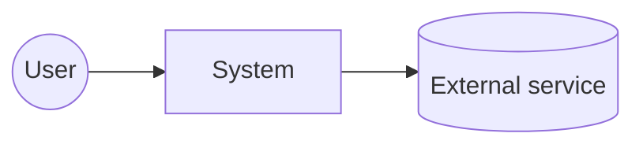
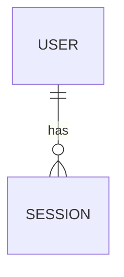
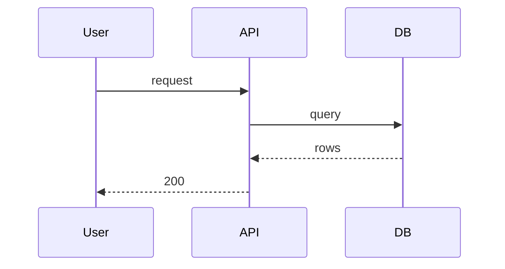

# Architecture overview
<!-- nstack-doc covers="src/**" verified="" -->

_Source: docs/product/prd.md · Date: YYYY-MM-DD · ADRs: docs/architecture/adr/_

## Requirements that shape the design
| Dimension | Now | 10× | Notes |
|---|---|---|---|
| Users / RPS | | | |
| Data volume | | | |
| Latency (critical path) | | | |
| Availability | | | |

Assumptions: <list>

## Context

## Components
| Component | Responsibility | Owns data | Interfaces |
|---|---|---|---|

## Data model

<Key fields, indexes, constraints, ownership.>

## API contracts

### `POST /api/<resource>`
- Auth: <...>
- Request: `{ ... }`
- Response 201: `{ ... }`
- Errors: 400 `VALIDATION_FAILED`, 401, 409 `<CODE>`
- Idempotency: <...>

## Critical flows

### <Flow name>

Failure path: <...>

## Failure modes
| Dependency | If slow | If down | Handling |
|---|---|---|---|

## Scaling plan
<What breaks first at 10× and the planned response.>

## Security
<Authn, authz, secrets, PII, top threats.>

## Observability
<Logs, errors, metrics, health check.>

## Deployment
<Environments, hosting, CI, rollback.>
